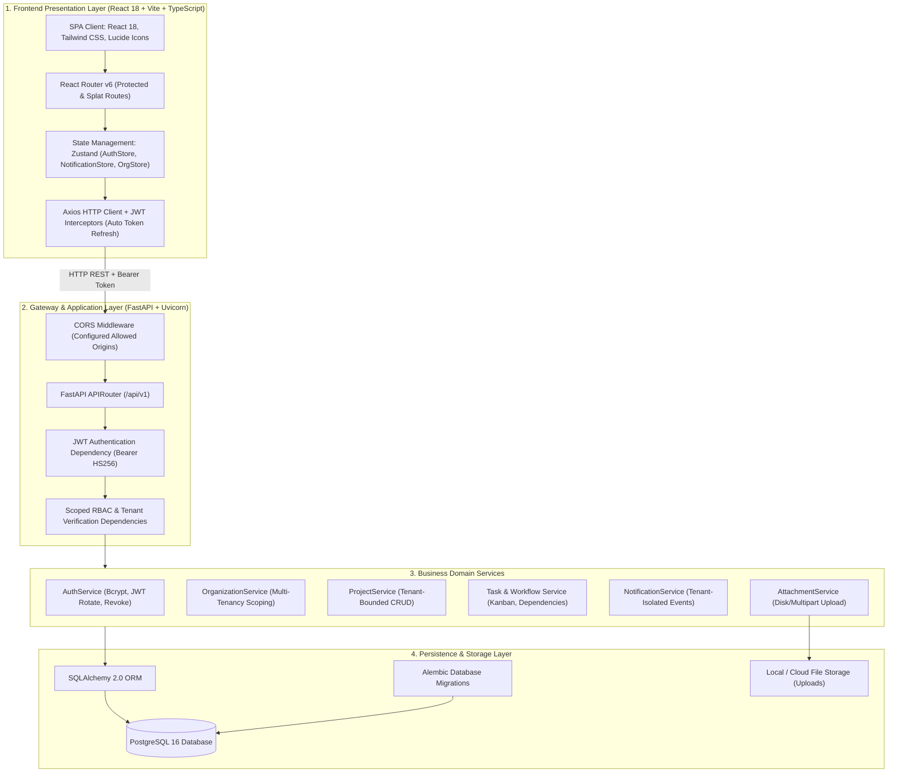
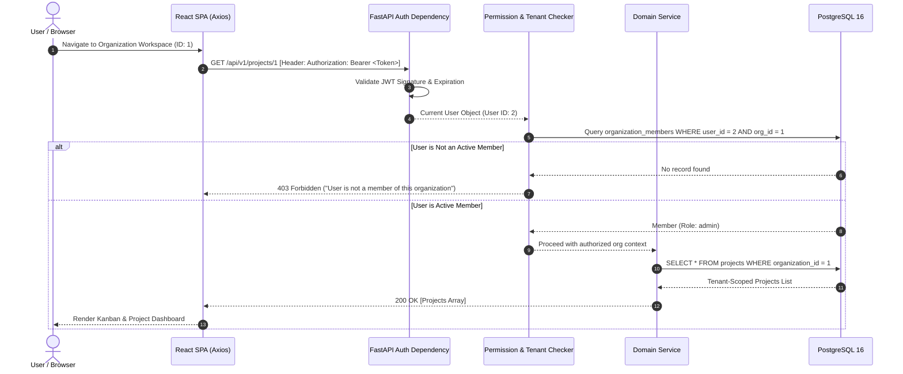
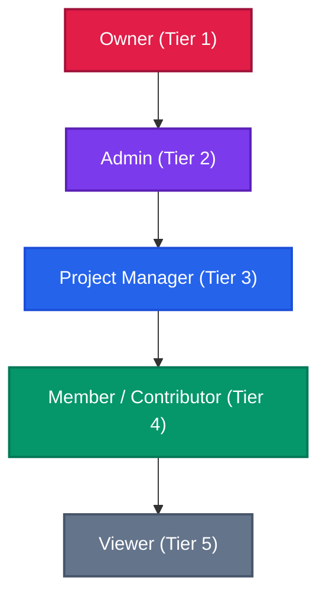
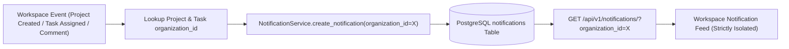

# System Architecture Diagram

This document illustrates the end-to-end system architecture, security perimeter, tenant isolation mechanisms, and role-based access control (RBAC) flow of the **Multi-Tenant Project & Workflow Management Platform**.

---

## 1. High-Level System Architecture

---

## 2. Multi-Tenant Request Isolation Flow

Each request operates strictly within the context of an authenticated user and an active organization workspace.

---

## 3. Role-Based Access Control (RBAC) Hierarchy

The platform implements a 5-tier role hierarchy enforced at both the API dependency layer and UI conditional components:

### RBAC Permission Matrix

| Capability | Owner | Admin | Project Manager | Member / Contributor | Viewer |
| :--- | :---: | :---: | :---: | :---: | :---: |
| **Manage Org Settings & Delete Org** | ✅ | ❌ | ❌ | ❌ | ❌ |
| **Invite & Modify Member Roles** | ✅ | ✅ | ❌ | ❌ | ❌ |
| **Create & Delete Projects** | ✅ | ✅ | ❌ | ❌ | ❌ |
| **Update Project Details** | ✅ | ✅ | ✅ | ❌ | ❌ |
| **Create Tasks & Assign Members** | ✅ | ✅ | ✅ | ✅ | ❌ |
| **Update Any Task & Status** | ✅ | ✅ | ✅ | Self-assigned only | ❌ |
| **Delete Tasks** | ✅ | ✅ | ✅ | Self-created only | ❌ |
| **Add Comments & Upload Attachments** | ✅ | ✅ | ✅ | ✅ | ❌ |
| **Read Projects, Tasks, Comments, Files** | ✅ | ✅ | ✅ | ✅ | ✅ |
| **Scoped Workspace Notifications** | ✅ | ✅ | ✅ | ✅ | ✅ |

---

## 4. Tenant-Scoped Notification Pipeline

To prevent cross-tenant notification leakage, every lifecycle event tags notifications with `organization_id`:

