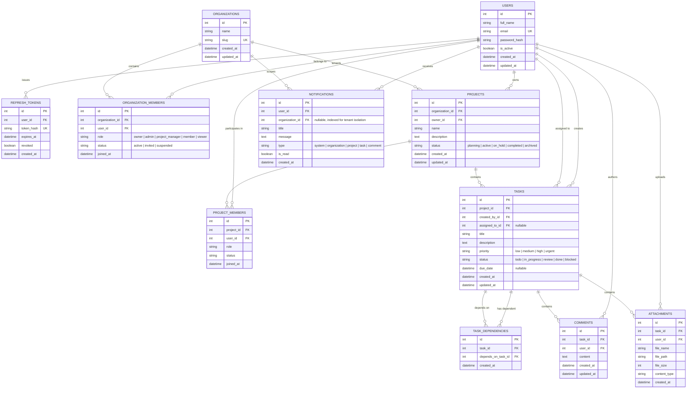

# Entity Relationship (ER) Diagram

This document models the relational schema for the **Multi-Tenant Project & Workflow Management Platform**, implemented with PostgreSQL and SQLAlchemy 2.0.

---

## 1. Mermaid Entity-Relationship Diagram

---

## 2. Table Specifications & Constraints

### 2.1 `users`
- **Primary Key**: `id` (`SERIAL` / `INTEGER`)
- **Indexes**: `email` (`UNIQUE INDEX`), `created_at`
- **Cascade Rules**: Deleting a user cascades to refresh tokens and notification subscriptions.

### 2.2 `organizations`
- **Primary Key**: `id` (`SERIAL` / `INTEGER`)
- **Indexes**: `slug` (`UNIQUE INDEX`)
- **Description**: Top-level tenant container. All projects, tasks, workflows, and workspace notifications are partitioned under an organization.

### 2.3 `organization_members`
- **Primary Key**: `id` (`SERIAL` / `INTEGER`)
- **Foreign Keys**:
  - `organization_id` $\rightarrow$ `organizations(id)` (`ON DELETE CASCADE`)
  - `user_id` $\rightarrow$ `users(id)` (`ON DELETE CASCADE`)
- **Unique Constraint**: `UNIQUE(organization_id, user_id)`
- **Roles**:
  - `owner`: Full administrative rights, organization billing, transfer, member role assignments, deletion.
  - `admin`: Member invitations, role management, project creation, task management.
  - `project_manager`: Project creation, workflow modification, task assignment, status updates.
  - `member`: Task creation, self-assigned task workflow updates, commenting, file attachments.
  - `viewer`: Read-only access to projects, tasks, dependencies, comments, and attachments.

### 2.4 `projects`
- **Primary Key**: `id` (`SERIAL` / `INTEGER`)
- **Foreign Keys**:
  - `organization_id` $\rightarrow$ `organizations(id)` (`ON DELETE CASCADE`)
  - `owner_id` $\rightarrow$ `users(id)` (`ON DELETE RESTRICT`)
- **Indexes**: `(organization_id, created_at)`

### 2.5 `tasks`
- **Primary Key**: `id` (`SERIAL` / `INTEGER`)
- **Foreign Keys**:
  - `project_id` $\rightarrow$ `projects(id)` (`ON DELETE CASCADE`)
  - `created_by_id` $\rightarrow$ `users(id)` (`ON DELETE RESTRICT`)
  - `assigned_to_id` $\rightarrow$ `users(id)` (`ON DELETE SET NULL`, nullable)
- **Indexes**: `(project_id, status)`, `(project_id, priority)`, `assigned_to_id`

### 2.6 `task_dependencies`
- **Primary Key**: `id` (`SERIAL` / `INTEGER`)
- **Foreign Keys**:
  - `task_id` $\rightarrow$ `tasks(id)` (`ON DELETE CASCADE`)
  - `depends_on_task_id` $\rightarrow$ `tasks(id)` (`ON DELETE CASCADE`)
- **Unique Constraint**: `UNIQUE(task_id, depends_on_task_id)`

### 2.7 `notifications`
- **Primary Key**: `id` (`SERIAL` / `INTEGER`)
- **Foreign Keys**:
  - `user_id` $\rightarrow$ `users(id)` (`ON DELETE CASCADE`)
  - `organization_id` $\rightarrow$ `organizations(id)` (`ON DELETE CASCADE`, nullable)
- **Indexes**: `(user_id, organization_id, is_read)`, `organization_id`
- **Tenant Scoping Guarantee**: Notifications emitted by project creations, task assignments, and organization events store `organization_id`. Frontend queries filter strictly with `?organization_id=:currentOrgId`, guaranteeing zero cross-tenant notification leaks.
